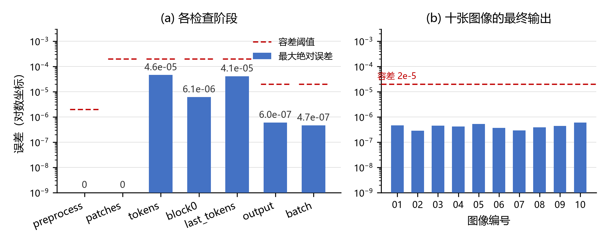

# 实验报告：基于 NumPy 的 OpenCLIP ViT-B-32 图像编码器

## 1 任务说明

本实验用纯 NumPy 复现 OpenCLIP ViT-B-32 图像塔的前向计算。输入为 `[B,3,224,224]` 的预处理图像批次和 152 个预训练张量，输出 512 维单位化图像 token，并要求与独立 FP32 参考输出在给定容差内一致。

模型几何固定：224×224 图像切为 32×32 补丁（7×7=49 个），宽度 768，12 个注意力头（每头 64 维），12 层 Transformer，MLP 宽度 3072，token 数 50（1 个 CLS 加 49 个补丁），输出 512 维；激活为 erf 形式的 GELU，LayerNorm epsilon 为 1e-5。线性权重按 `[out,in]` 存储，`visual.proj` 例外，已为 `[in,out]`。

## 2 方法与实现

实现只修改 `image_encoder.py`，其余文件保持课程提供的原样。表 1 汇总六个 TODO 的输入输出与实现选择，随后说明三处关键设计理由。

表 1　六个 TODO 的输入输出、关键算子与易错点

| TODO | 函数 | 输入 → 输出 | 关键算子 | 易错点 |
|------|------|-------------|----------|--------|
| 01 | patchify | [B,3,224,224] → [B,49,3072] | reshape 为网格后 transpose(0,2,4,1,3,5)，再展平 | 轴序决定补丁排列，写错会打乱网格 |
| 02 | split_heads | [B,N,768] → [B,12,N,64] | reshape(B,N,12,64) 后 transpose(0,2,1,3) | 漏 transpose 时形状仍可算，数值全错 |
| 03 | `MHA.__call__` | [B,N,768] → [B,N,768] | qkv 投影；q@kᵀ/√64；softmax；系数@v；合并头；输出投影 | k 只交换最后两轴，全轴转置直接报维度错 |
| 04 | TransformerBlock | [B,N,768] → [B,N,768] | 预归一化→注意力→残差；归一化→MLP→残差 | 残差加子层输入，而非归一化后的值 |
| 05 | embed | [B,49,3072] → [B,50,768] | 补丁投影（无偏置）+ CLS 前置 + 位置编码 | CLS 需广播到 batch，位置数与 token 数须匹配 |
| 06 | `__call__` | [B,50,768] → [B,512] | 取 CLS→post_norm→乘 visual.proj→单位化 | visual.proj 是 [in,out]，不可再转置 |

补丁顺序必须与预训练一致。位置编码在训练时按行优先排列（先左后右、再上到下），因此 patchify 的 transpose 顺序一旦改变，补丁 token 就会与位置向量错配；`patches` 阶段误差为 0 直接验证了该顺序。

缩放因子 `1/√head_dim` 使点积得分的方差不随头维度增长，softmax 不会进入饱和区，这一约定与预训练实现一致。权重方向则由存储约定决定：`[out,in]` 是 PyTorch Linear 的布局，矩阵乘前需转置；`visual.proj` 在 OpenCLIP 中按 `[in,out]` 保存，可直接右乘。残差路径同样关键：预归一化结构要求残差加回子层输入 `x`，而非归一化后的 `u`。

在几何参数上，编码器不再写死常量：补丁大小、通道数、层数、头数取自 `config.json`（缺省时由权重形状推断），位置编码长度与 patch 数不一致、图像尺寸不能被补丁整除、宽度不能被头数整除时都会抛出明确错误，便于助教用其他分辨率复现。

## 3 个人贡献

- 阅读 starter 框架、讲义代码映射与 `transformer_steps.py` 微型示例，梳理六个 TODO 的调用链与形状变化。
- 补全 `image_encoder.py` 的六个 TODO：核心计算约 20 行，另有配置解析与形状校验约 20 行。
- 每个 TODO 完成后立即用 `check.py` 分阶段校验，按“先形状、后数值”的顺序定位并修正注意力转置错误，最终 8 个阶段全部通过。
- 用 `run.py` 生成 10 张图像的 `output_tokens.npz`，重复运行结果一致（与参考输出逐元素最大差 5.96e-07）。
- 维护 `README.md`（快速开始、实测环境、分阶段误差表）并撰写本报告。

## 4 结果与证据

运行 `python check.py --stage all`，8 个阶段全部通过，终端输出节选如下：

```
assets       PASS: 152 matching visual tensors and ten image/reference pairs
preprocess   PASS shape=(10, 3, 224, 224) max_abs=0.000e+00
patches      PASS shape=(2, 49, 3072) max_abs=0.000e+00
tokens       PASS shape=(2, 50, 768) max_abs=4.578e-05
...
output       PASS shape=(10, 512) max_abs=5.960e-07
batch        PASS shape=(3, 512) max_abs=4.657e-07
Requested numerical checks passed. The reference file is never an encoder input.
```

图 1 将各阶段误差与十张图像各自的最终误差放在同一对数坐标下，红线为容差阈值。



- `preprocess` 与 `patches` 误差为 0，说明缩放、裁剪、归一化与补丁切分完全复现了参考流程。
- 中间阶段最大误差不超过 4.58e-05，距 2e-04 容差尚有一个数量级余量；`output` 阶段误差 5.96e-07，比 2e-05 容差小约 33 倍。
- 十张图像各自的输出误差在 2.85e-07 至 5.96e-07 之间，余弦相似度均不低于 0.9999999，输出模长均为 1，说明结果不依赖具体输入内容。
- `batch` 阶段用乱序且重复的批次（[1,0,1]）验证了 batch 处理逻辑，误差 4.66e-07，说明实现与 batch 顺序无关。

## 5 分析与反思

### 5.1 关键形状与误差传播

`patchify` 用一次 reshape 把 H、W 拆成“网格轴 + 补丁轴”，再用 transpose 把网格轴提到补丁轴之前；`split_heads` 把特征轴拆成 `(heads, head_dim)` 并将头轴前移，使每个头独立处理全部 token；注意力在最后两轴完成 N×N 比较后，再转置回并 reshape 合并。整个前向没有参数更新，误差只来自 float32 累加顺序与 LayerNorm、GELU 的实现差异：`tokens` 阶段约 4.6e-05，经过 12 层后 `last_tokens` 仍为 4.1e-05，而 `output` 降到 6e-07，一方面 post_norm 与 768→512 投影对误差做了平均，另一方面 `unit_vector` 把输出约束在单位球上，绝对误差不再随模长放大。

### 5.2 真实失败与定位

实现过程中出现过两类错误，均在分阶段校验中暴露。第一类是把注意力得分写成 `q @ k.T`：4D 张量的全轴转置形状变为 `[64,N,H,B]`，矩阵乘立即失败：

```
ValueError: matmul: Input operand 1 has a mismatch in its core dimension 0,
with gufunc signature (n?,k),(k,m?)->(n?,m?) (size 12 is different from 64)
```

第二类更隐蔽：`split_heads` 只 reshape 而未 transpose，形状仍是 `[B,N,H,64]`，后续矩阵乘与合并都能走通，但头与 token 轴错位。此时 `block0` 阶段给出

```
block0       FAIL shape=(2, 50, 768) max_abs=1.825e+00 mean_abs=9.214e-02
```

按“先对形状、再对数值”的顺序逐段比对各阶段输出，可以把问题限定在注意力内部的两个 transpose 上，修正后 `block0` 误差降到 6.1e-06。这段经历说明：形状正确不代表计算正确，分阶段数值校验比端到端比对更容易定位。

### 5.3 局限与改进

- 速度：`helpers.py` 的 GELU 用 Python 逐元素调用 `math.erf`，是前向的主要瓶颈，10 张图约 5.7 s。将 erf 向量化可显著加速，但会偏离课程给定的精确实现，故未改动。
- 内存：311 MB 权重常驻内存，每层还需保存 `[B,50,3072]` 的 MLP 中间激活，batch 增大时内存线性增长；可改为逐图推理或分块计算。
- 数值：误差主要来自 12 层 float32 累加与实现差异，目前余量充足，但若扩展到更大 batch 或不同分辨率，应重新核对容差。
- 可验证性：当前校验完全依赖课程提供的参考文件，缺少独立自测；可补一个小型回归脚本，把当前误差基线固化下来。

## 6 复现环境与协作

实测环境为 Python 3.13.7、NumPy 2.5.4、Pillow 13.0.0，Windows 11，纯 CPU（不依赖 GPU、PyTorch 或 OpenCLIP 包）。`python check.py --stage all` 约 6.8 s，`python run.py` 处理 10 张图约 5.7 s。`requirements.txt` 给出可运行版本区间，权重与示例图随课程附件提供，311 MB 的权重文件不纳入版本库。

使用课程提供的 `helpers.py`（LayerNorm、GELU、softmax、单位化）、`preprocess_image.py`、`runtime.py`、`check.py`、`run.py`、`transformer_steps.py`，均未修改；计算顺序参考 `PPT-CODE-MAP.txt` 的讲义映射，权重布局与 GELU 形式对照 OpenCLIP 与 ViT 原始实现的约定。未使用外部网络资源。

**结论**：六个 TODO 全部完成，`check.py --stage all` 八阶段通过，输出 token 与独立 FP32 参考在要求容差内一致，可直接作为最终项目图像塔的 NumPy 参考实现。